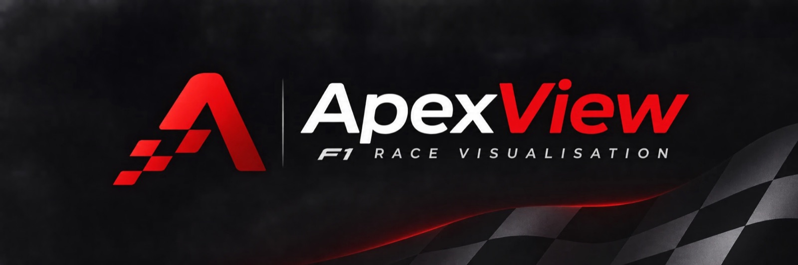
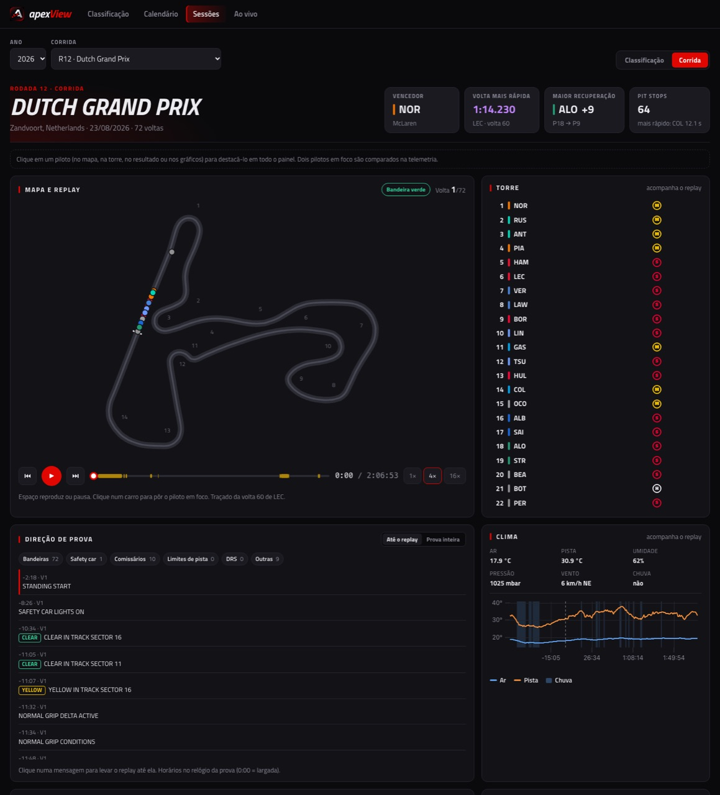
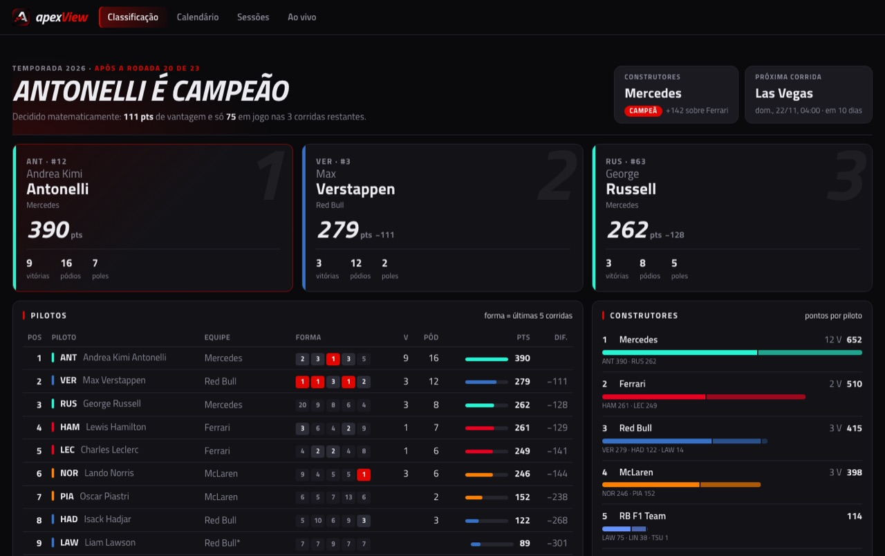
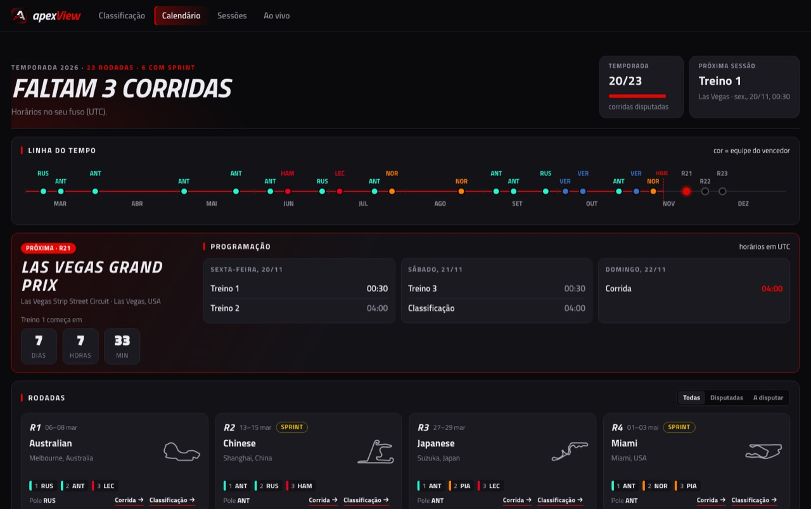

<p align="center">
  
</p>

<p align="center">
  <b>Campeonato, calendário, replay das corridas e telemetria de Fórmula 1, num site só.</b><br>
  Gratuito, aberto e feito por fã, para fãs.
</p>

<p align="center">
  <a href="https://apexview-peach.vercel.app"><b>🏁 Abrir o site</b></a>
  &nbsp;·&nbsp;
  <a href="#-como-usar">Como usar</a>
  &nbsp;·&nbsp;
  <a href="#-modo-ao-vivo">Modo ao vivo</a>
  &nbsp;·&nbsp;
  <a href="#-rodar-no-seu-computador">Rodar no seu computador</a>
</p>

---

## 🏎️ O que é

O **apexView** transforma os dados oficiais de cronometragem da F1 em painéis fáceis de ler: o campeonato, o calendário no seu fuso, o replay de qualquer corrida no mapa da pista, a telemetria volta a volta e, no seu computador, as sessões ao vivo.

<p align="center">
  
</p>

<table>
  <tr>
    <td width="50%" align="center"></td>
    <td width="50%" align="center"></td>
  </tr>
</table>

---

## 🚦 Como usar

Abra **https://apexview-peach.vercel.app** no computador ou no celular. Não precisa instalar nada.

- **Classificação:** a situação do título, o pódio do campeonato e as tabelas de pilotos e construtores.
- **Calendário:** a próxima etapa com contagem regressiva e todas as rodadas. Clique em **Corrida →** para abrir uma etapa.
- **Sessões:** o painel de uma corrida, classificação ou treino:
  - **Replay:** aperte **▶** e arraste a linha do tempo; a torre, a direção de prova e o clima acompanham.
  - **Telemetria:** compare a volta de dois pilotos (velocidade, acelerador, freio, marcha e diferença).
  - **Mini setores:** veja quem foi mais rápido em cada trecho da volta.
- **Clique num piloto** em qualquer lugar para destacá-lo em todos os cartões.

📱 No celular, use **Adicionar à tela de início** para ter o apexView como um app.

---

## 🔴 Modo ao vivo

Mostra a sessão em tempo real: os dois pilotos em foco, o mapa (com os carros ou o domínio de cada mini setor), a telemetria da volta e a torre de tempos. Fora dos fins de semana de GP, simula qualquer sessão desde 2018.

Ele roda **no seu computador**, porque usa a sua assinatura **F1 TV**. Com o projeto baixado:

```bash
cd live
python3 -m venv .venv
source .venv/bin/activate        # Windows: .venv\Scripts\activate
pip install -r requirements.txt
python server.py
```

Deixe o terminal aberto e abra a aba **Ao vivo** do site:
- Clique em **Entrar com a F1 TV** e entre com a sua assinatura. A senha vai direto para a F1 e não fica salva.
- No horário de uma sessão, o ao vivo liga sozinho. Ajuste o **Atraso** para sincronizar com a TV.
- Fora das sessões, use **Trocar sessão** para simular outra.

Depois de atualizar o projeto (`git pull`), pare o backend com **Ctrl+C** e rode `python server.py` de novo.

<details>
<summary><b>Outros modos e segurança</b></summary>

- `python server.py live` força o ao vivo; `python server.py replay [ARQUIVO]` só simula uma gravação.
- O servidor escuta apenas em `127.0.0.1:8000`. Não o exponha na internet: o feed é só para uso pessoal.
- Só o site local e o publicado conseguem conectar. Para outro endereço, use `--allow-origin https://seu-site`.
- Se a F1 pedir uma verificação que a página de login não consegue fazer, rode um export do pipeline: o FastF1 pede e-mail e senha no terminal, e o backend passa a usar esse acesso.

</details>

---

## 💻 Rodar no seu computador

Você precisa de **Node 20+**, **Python 3.10+** e **Git**.

```bash
git clone https://github.com/GuiCPessoa/apexView.git
cd apexView/web
npm install
npm run dev
```

Abra o endereço que aparecer (normalmente http://localhost:5173). O site lê os dados já exportados em `data/`.

Para atualizar os dados, use o pipeline:

```bash
cd pipeline
python3 -m venv .venv
source .venv/bin/activate        # Windows: .venv\Scripts\activate
pip install -r requirements.txt
```

| Comando | O que faz | Login F1 TV? |
|---|---|:---:|
| `python export_standings.py 2026` | Calendário e classificação | — |
| `python export_session.py 2026 Monza R` | Uma sessão (`FP1`…`FP3`, `SQ`, `S`, `Q`, `R`) | ✅ |
| `python export_season.py 2024 2025 2026` | Todas as corridas das temporadas | ✅ |

Na primeira vez, o FastF1 pede o login da F1 TV no terminal (ou use o login da aba **Ao vivo**, que vale para os dois). Comece com uma ou duas corridas. Depois de exportar, faça commit e push de `data/`: o site publicado se atualiza sozinho.

<details>
<summary><b>Testes, deploy e estrutura</b></summary>

```bash
cd web && npm test               # site
cd pipeline && pytest            # exportação
cd live && pytest                # ao vivo
```

- **Deploy:** o site é estático e fica na Vercel (plano gratuito, pasta raiz `web/`). Todo push na `main` publica uma versão nova. Cache e cabeçalhos de segurança estão em `web/vercel.json`.
- **Pessoas online:** o contador da barra superior usa o Firebase Realtime Database (plano gratuito). As regras estão em `firebase/database.rules.json`.
- **Pastas:** `pipeline/` exporta os dados, `data/` guarda o resultado (formato em [`docs/data-format.md`](docs/data-format.md)), `web/` é o site e `live/` é o backend do ao vivo.

Guia completo de arquitetura, setup e roadmap: [`INICIO.md`](INICIO.md).

</details>

---

## 🙌 Créditos

Dados do [FastF1](https://github.com/theOehrly/Fast-F1), do [Jolpica-F1](https://github.com/jolpica/jolpica-f1) e do [LiveF1](https://github.com/GoktugOcal/LiveF1) (feed oficial de live timing da F1, só para uso pessoal).

<sub>Projeto pessoal, gratuito e não comercial. Não tem ligação com a Fórmula 1, a FIA ou as equipes. Os dados de corrida pertencem aos seus donos.</sub>
