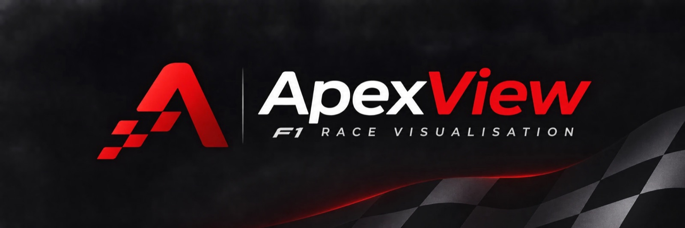
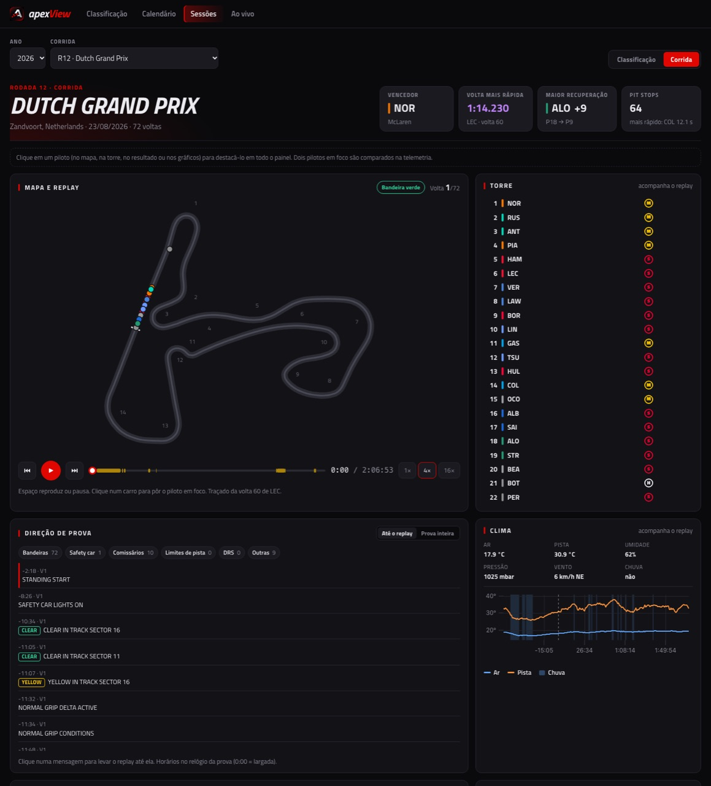
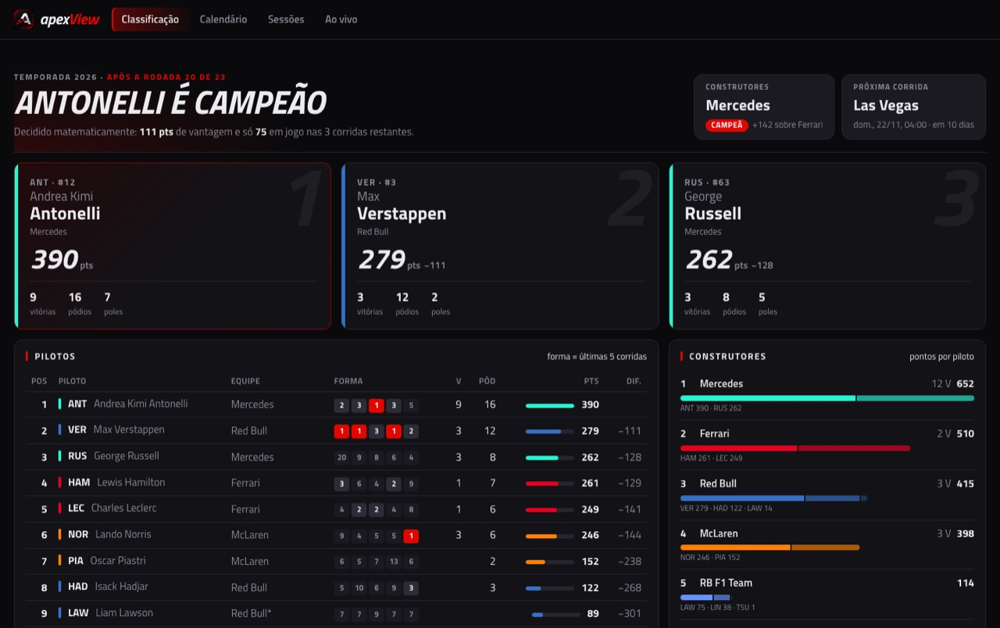
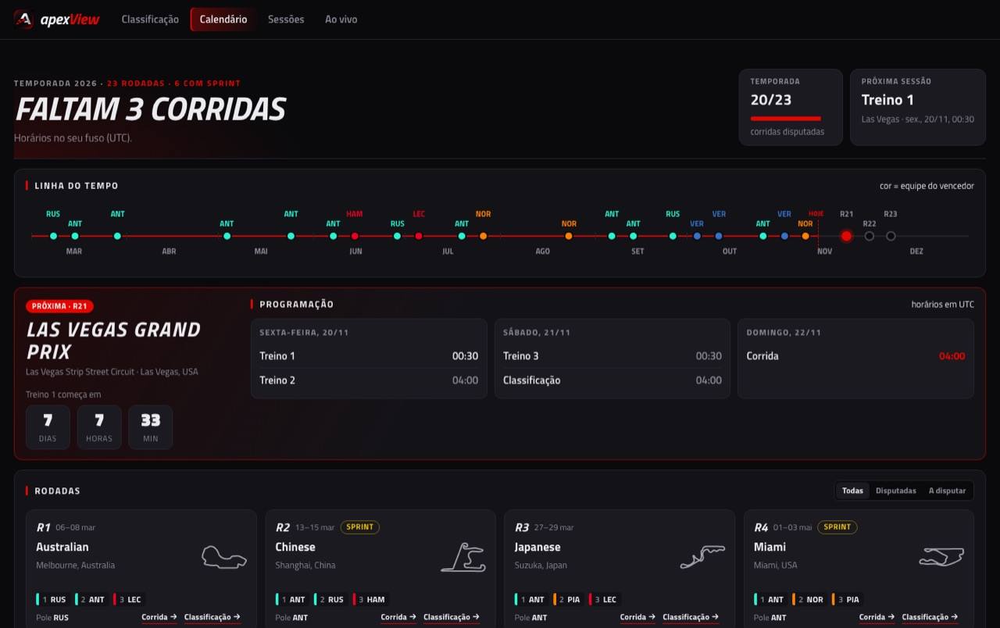
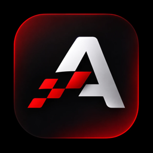

<p align="center">
  
</p>

<p align="center">
  <b>Campeonato, calendário, replay das corridas e telemetria de Fórmula 1, num site só.</b><br>
  Gratuito, aberto e feito por fã, para fãs.
</p>

<p align="center">
  <a href="https://apexview-peach.vercel.app"><b>🏁 Abrir o site</b></a>
  &nbsp;·&nbsp;
  <a href="#-tutorial-em-5-minutos">Tutorial</a>
  &nbsp;·&nbsp;
  <a href="#-rodar-no-seu-computador">Rodar no seu computador</a>
  &nbsp;·&nbsp;
  <a href="#-modo-ao-vivo">Modo ao vivo</a>
</p>

<p align="center">
  
  
  
  
  
</p>

---

## 🏎️ O que é

O **apexView** transforma os dados oficiais de cronometragem da F1 em painéis fáceis de ler. Dá para:

- 🏆 **acompanhar o campeonato:** quem lidera, por quantos pontos e se o título já está decidido;
- 📅 **ver o calendário:** a próxima corrida com contagem regressiva, no seu fuso horário;
- 🗺️ **assistir de novo a qualquer corrida** no mapa da pista, com a torre de posições, as bandeiras, o clima e as mensagens da direção de prova;
- 📈 **comparar pilotos volta a volta:** velocidade, acelerador, freio e marcha em cada curva;
- 🔴 **seguir uma sessão ao vivo** no seu computador, com mapa, tempos e telemetria (precisa de assinatura F1 TV).

<p align="center">
  
  <br><sub>Replay do GP da Holanda: carros no mapa, torre de posições, mensagens da direção de prova e clima, tudo sincronizado.</sub>
</p>

<table>
  <tr>
    <td width="50%" align="center">
      
      <br><sub><b>Classificação:</b> situação do título, top 3, pilotos e construtores.</sub>
    </td>
    <td width="50%" align="center">
      
      <br><sub><b>Calendário:</b> linha do tempo, próxima rodada e todas as etapas.</sub>
    </td>
  </tr>
</table>

---

## 🚦 Tutorial em 5 minutos

Não precisa instalar nada: abra **https://apexview-peach.vercel.app** no computador ou no celular.

### 1. Veja como está o campeonato
A primeira tela é a **Classificação**. No topo está a frase que resume a temporada ("Antonelli é campeão", "faltam 3 corridas"...).
- Os três cartões mostram o pódio do campeonato, com vitórias, pódios e poles.
- Na tabela de pilotos, a coluna **Forma** mostra as últimas 5 corridas: vermelho é vitória, `AB` é abandono.
- Troque a temporada no seletor do canto superior direito.

### 2. Descubra quando é a próxima corrida
Clique em **Calendário**.
- O cartão vermelho mostra a próxima etapa, a contagem regressiva e os horários do fim de semana, já no seu fuso.
- Abaixo, cada rodada tem o desenho do circuito e o pódio. Use **Disputadas** e **A disputar** para filtrar.
- Clique em **Corrida →** em qualquer etapa já disputada para abrir o painel dela.

### 3. Assista ao replay de uma corrida
No painel da corrida (ou pela aba **Sessões**, escolhendo ano e GP):
1. Aperte **▶** (ou a barra de espaço) e escolha a velocidade: **1×**, **4×** ou **16×**.
2. Arraste a **linha do tempo** para pular. As faixas coloridas marcam bandeira amarela, safety car e bandeira vermelha.
3. A **Torre**, ao lado, mostra as posições, os pneus e quem está nos boxes naquele momento.
4. Embaixo, a **Direção de prova** lista as mensagens oficiais até aquele instante. **Clique numa mensagem** para o replay ir até ela, e use os filtros para ver só penalidades, bandeiras ou safety car.
5. O cartão **Clima** mostra temperatura do ar e da pista, vento e chuva, com o gráfico da prova inteira.

### 4. Ponha pilotos em foco
**Clique num piloto** em qualquer lugar (no carro do mapa, na torre, no resultado ou num gráfico). Ele fica destacado em todos os cartões. Clique em um segundo piloto para comparar os dois; clique de novo para tirar o destaque.

### 5. Compare a telemetria
No cartão **Telemetria**, escolha o piloto **A** e o piloto **B** e a volta de cada um (a mais rápida já vem escolhida).
- Os gráficos mostram velocidade, acelerador, freio e marcha ao longo da volta, com o número das curvas.
- O gráfico de **Diferença** mostra onde um ganhou tempo do outro.
- Passe o mouse para ver os valores; arraste para dar zoom; clique duas vezes para voltar.
- Quer ver só um piloto? No seletor **B**, escolha **Nenhum · só o piloto A**.

<table>
  <tr>
    <td width="96" align="center"></td>
    <td>
      <b>📱 Use como app no celular</b><br>
      Abra o site no celular e escolha <b>Adicionar à tela de início</b> (Safari: botão Compartilhar; Chrome: menu ⋮). O apexView aparece com este ícone, como um app.
    </td>
  </tr>
</table>

---

## 🔴 Modo ao vivo

Durante os treinos, a classificação e a corrida, o apexView mostra a sessão em tempo real: mapa com os carros, torre de tempos, telemetria, clima e direção de prova. Fora dos fins de semana de GP, ele simula qualquer sessão desde 2018 como se fosse ao vivo.

Ele roda **no seu computador**, porque usa a sua assinatura **F1 TV**. Siga primeiro [Rodar no seu computador](#-rodar-no-seu-computador) para ter o login, depois:

```bash
cd live
python3 -m venv .venv
source .venv/bin/activate        # Windows: .venv\Scripts\activate
pip install -r requirements.txt
python server.py
```

Deixe o terminal aberto e vá à aba **Ao vivo** do site (o publicado ou o local).
- **No horário de uma sessão**, o ao vivo liga sozinho e grava o feed em `live/recordings/`. Ajuste o **Atraso** para sincronizar com a TV.
- **Fora das sessões**, use **Trocar sessão** para escolher outra. As que ainda não foram baixadas chegam em cerca de 1 minuto. Dá para pausar, mudar a velocidade e pular.
- Na **Telemetria ao vivo**, escolha **Um piloto** ou **Comparar dois** e clique na torre para escolher quem acompanhar.

<details>
<summary><b>Outros modos e segurança do servidor</b></summary>

- `python server.py live` força o ao vivo, e `python server.py replay [ARQUIVO]` só simula uma gravação.
- O servidor escuta apenas em `127.0.0.1:8000`. Não o exponha na internet: ele usa a sua assinatura F1 TV, e o feed é só para uso pessoal.
- Pelo navegador, só o site local (`localhost`) e o site publicado conseguem conectar; qualquer outro site é recusado. Se publicar o site em outro endereço, libere-o com `python server.py --allow-origin https://seu-site` ou com a variável `APEXVIEW_ALLOWED_ORIGINS`.
- Os horários das sessões vêm de `data/{ano}/calendar.json`, então mantenha o calendário exportado.

</details>

---

## 💻 Rodar no seu computador

Você precisa de **Node 20+**, **Python 3.10+** e **Git**.

**1. Baixe o projeto e abra o site**
```bash
git clone https://github.com/GuiCPessoa/apexView.git
cd apexView/web
npm install
npm run dev
```
Abra o endereço que aparecer (normalmente http://localhost:5173). Os dados já exportados ficam em `data/` e o site lê direto de lá.

**2. (Opcional) Atualize os dados com o pipeline**
```bash
cd pipeline
python3 -m venv .venv
source .venv/bin/activate        # Windows: .venv\Scripts\activate
pip install -r requirements.txt
python export_standings.py 2026  # calendário e classificação, sem login
```

| Comando | O que faz | Login F1 TV? |
|---|---|:---:|
| `python export_standings.py 2026` | Calendário, classificação, estatísticas e traçados do calendário | — |
| `python export_session.py 2026 Monza R` | Uma sessão (`FP1`, `FP2`, `FP3`, `SQ`, `S`, `Q` ou `R`): resultados, voltas, telemetria, replay, clima e direção de prova | ✅ |
| `python export_season.py 2024 2025 2026` | Todas as corridas das temporadas | ✅ |

> [!TIP]
> **Login F1 TV:** na primeira vez, o FastF1 pede o e-mail e a senha da sua conta F1 TV no terminal. O token fica fora do repositório e vale por alguns dias; quando vencer, ele pede de novo. Comece com uma ou duas corridas antes de exportar uma temporada inteira: o FastF1 guarda um cache em `pipeline/cache/` e as consultas ao Jolpica respeitam o limite de uso.

Depois de exportar, faça commit e push de `data/`: o site publicado se atualiza sozinho.

<details>
<summary><b>Testes</b></summary>

```bash
cd web && npm test               # lógica do site (web/src/lib)
cd pipeline && pytest            # exportação dos dados
cd live && pytest                # modo ao vivo
```

</details>

<details>
<summary><b>Deploy</b></summary>

O site é estático (o build do `web/` mais os arquivos de `data/`) e fica na **Vercel**, no plano gratuito, com `web/` como pasta raiz.
- Todo push na branch `main` publica uma nova versão em https://apexview-peach.vercel.app.
- O cache está em `web/vercel.json`: os arquivos do build ficam em cache por 1 ano, e os dados por 5 minutos.
- O mesmo arquivo define os cabeçalhos de segurança, incluindo a política de conteúdo (CSP): o site só carrega scripts próprios e as fontes do Google Fonts, e só conecta no backend local em `ws://127.0.0.1:8000`. Se mudar a porta do backend (`VITE_LIVE_URL`) ou adicionar outro serviço externo, ajuste o `connect-src` da CSP.

</details>

<details>
<summary><b>Estrutura do projeto</b></summary>

```
pipeline/   scripts Python de exportação (FastF1 + Jolpica)
data/       dados exportados, lidos pelo site (formato em docs/data-format.md)
web/        site em Vite + React + TypeScript (mapa em SVG, uPlot na telemetria)
live/       backend local do modo ao vivo (LiveF1 + FastAPI + WebSocket)
docs/       documentação do formato dos dados e imagens do README
```

Guia completo de arquitetura, setup e roadmap: [`INICIO.md`](INICIO.md).

</details>

---

## 🙌 Dados e créditos

- [FastF1](https://github.com/theOehrly/Fast-F1): sessões, voltas, telemetria, posições e clima.
- [Jolpica-F1](https://github.com/jolpica/jolpica-f1): calendário, resultados e classificação.
- [LiveF1](https://github.com/GoktugOcal/LiveF1) e o feed oficial de live timing da F1 (não documentado): modo ao vivo, só para uso pessoal.

<sub>Projeto pessoal, gratuito e não comercial, para estudo e diversão entre amigos. Não tem ligação com a Fórmula 1, a FIA ou as equipes. Os dados de corrida pertencem aos seus donos.</sub>
